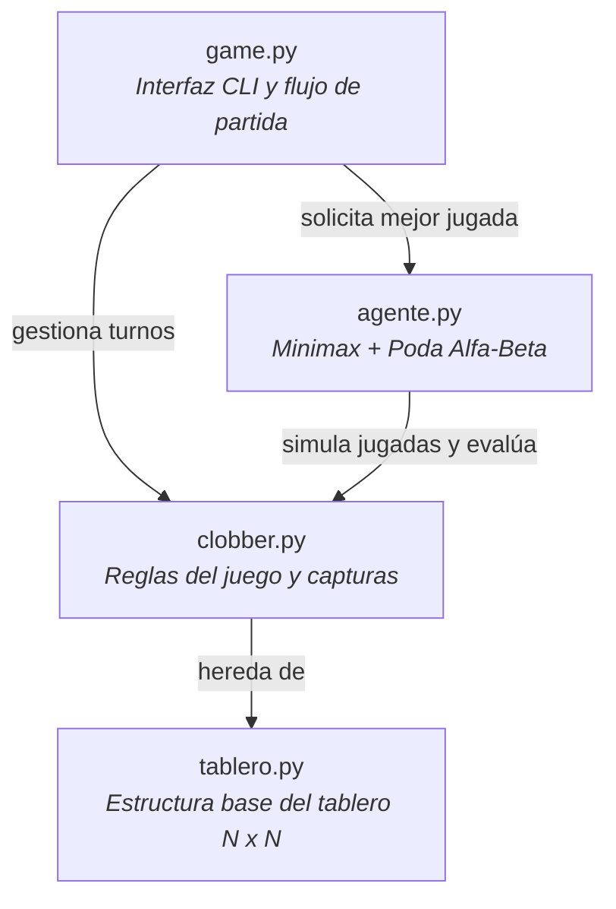

# Clobber AI Agent — Minimax & Alpha-Beta Pruning

## Autores
*  Andrés Peña
*  Patricio Frez
*  Ian Arroyo

Agente inteligente implementado en Python para jugar al juego de estrategia **Clobber** contra un usuario humano mediante consola. El agente utiliza el algoritmo **Minimax con poda Alfa-Beta** y una heurística de evaluación posicional y territorial.

## Características Clave
* **Algoritmo de Búsqueda:** Minimax con poda Alfa-Beta (Alpha-Beta Pruning) con límite de profundidad configurable.
* **Ordenamiento de Jugadas:** Move ordering previo para maximizar el número de podas de ramas ineficientes y optimizar el tiempo de respuesta.
* **Función Heurística Personalizada:**
  * **Agrupación estratégica:** Bonificación por estructuras de bloques 2x2.
  * **Movilidad neta:** Maximización de capturas disponibles respecto al oponente.
  * **Aislamiento del rival:** Control táctico penalizando la adyacencia de fichas enemigas.
  * **Control de bordes y esquinas:** Penalización posicional suave para prevenir desventajas tácticas.

## Arquitectura de Módulos

El proyecto está diseñado de forma modular bajo principios de programación orientada a objetos:



## Ejecución

```bash
python game.py
